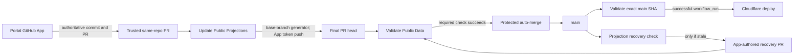

# GitHub Actions Automation

## Purpose

The repository accepts authoritative public-data updates from
`scs-portal-github-app[bot]`, deterministically generates projections, validates
the final pull-request head, merges only through branch protection, and deploys
only a validated `main` commit.

## Root Cause of the Approval Loop

PR #100 was opened by `scs-portal-github-app[bot]` at commit `8503444`. The
original `Validate Public Data` run generated projections and pushed commit
`0bb864c` with the repository `GITHUB_TOKEN`, whose actor was
`github-actions[bot]`. GitHub created run `40817631146` for that synchronization
event with conclusion `action_required`; it ran only after a maintainer approved
attempt 2.

This is documented GitHub behavior, not a fork-policy misconfiguration. When a
workflow creates or updates a PR with `GITHUB_TOKEN`, `opened`, `synchronize`,
and `reopened` PR runs are created in an approval-required state. A GitHub App
installation token triggers the normal automatic behavior instead.

## Architecture

### Trust boundaries

- `Validate Public Data` is the stable required check. It has only
  `contents: read` and `packages: read`, does not persist checkout credentials,
  and never generates or commits files. Its install token is available only to
  `bun install`, which uses a runner-owned registry configuration and disables
  dependency lifecycle scripts.
- `Update Public Projections` uses `pull_request_target` only as a privileged
  coordination event. It accepts only same-repository PRs whose REST author is
  `scs-portal-github-app[bot]` and whose branch matches a portal operation.
- Before creating an installation token, the updater rejects any PR that changes
  a path outside the three public v2 data trees.
- The updater checks out generator code and dependencies from the protected base
  branch into `trusted/`. PR data is checked out separately into `candidate/`;
  no candidate scripts, dependency manifests, hooks, or workflow code execute.
- The App token is scoped to this repository and to `contents: write` for the
  projection commit. The push uses both a live-head check and force-with-lease.
- Auto-merge rechecks the GraphQL App author (`app/scs-portal-github-app`),
  repository, branch family, operation label, and auto-merge label before it
  creates a token with `contents: write` and `pull-requests: write`.
- Auto-merge concurrency includes the triggering label. An ordinary operation
  label therefore cannot cancel the simultaneous `auto-merge-*` label event.
- The recovery workflow runs only from trusted `main`, uses the App identity,
  and updates its single branch with force-with-lease. It is defense in depth
  for direct or administrative updates that somehow reach `main` with stale
  projections.
- Deployment consumes `workflow_run.head_sha` only when `Validate Public Data`
  succeeded on branch `main`. It compares that SHA with the live `main` ref,
  skips superseded validation events, and uses one immutable SHA for both its
  validation and deployment jobs. PR validation can never deploy.

### Canonical schema package

The private `@csc3213-2026-group-b/scs-schemas` package contains the compiled
runtime schemas from `packages/schemas` in the private monorepo. A monorepo
workflow publishes a new package version whenever that folder changes on
`main`. This repository pins an exact version and has package Actions access,
so it consumes the schema artifact without exposing the monorepo source or
granting access to the monorepo repository.

Because this repository is public, granting it Actions access to a private
package may also make that package available to workflows from forks under
GitHub's package permission model. The package contains only the intended
compiled schemas. Workflows never expose the package token to test or build
commands, and installation runs with lifecycle scripts disabled.

## Required GitHub App and Secret Configuration

The existing `scs-portal-github-app` installation has sufficient repository
permissions:

- Contents: read and write.
- Pull requests: read and write.
- Metadata: read (implicit and already installed).

The workflows request narrower per-token permissions where possible. They do
not require a PAT, Actions permission, Checks permission, or Workflows
permission.

Configure these repository-level Actions values:

- Variable `SCS_PORTAL_GITHUB_APP_CLIENT_ID`: `Iv23liFVjTUopfW9GYUS`.
- Secret `SCS_PORTAL_GITHUB_APP_PRIVATE_KEY`: the existing App private key in
  PEM form.

Do not generate a second App or a replacement key for this workflow. Copying
the existing private key into GitHub Actions expands where that credential is
stored and must be performed by an authorized App administrator. Once stored,
GitHub masks the value and `actions/create-github-app-token` revokes generated
installation tokens at the end of each job.

## Repository Settings

The target repository configuration is:

- Actions enabled with only the required action owners/patterns allowed.
- Maintained major action tags are used so compatible security and runtime
  updates are adopted automatically. Repository SHA enforcement remains off.
- Default `GITHUB_TOKEN` permission: read.
- GitHub Actions may not create or approve pull requests; App tokens perform
  those mutations.
- All external contributors require approval before fork PR workflows run.
  This does not affect same-repository PRs opened by the installed App.
- Auto-merge enabled.
- `main` protected with strict required check `Validate Public Data`, sourced
  from GitHub Actions, and force pushes and deletions disabled.

Keep SHA enforcement disabled while workflows use maintained major tags. The
read-only default is safe before merge because every current write operation
already declares explicit job or workflow permissions.

### Applied configuration snapshot (2026-10-29)

- Actions are enabled in `selected` mode. GitHub-owned actions are allowed;
  third-party patterns are limited to `oven-sh/setup-bun@v2` and
  `cloudflare/wrangler-action@v4`.
- SHA enforcement is disabled because this repository intentionally tracks
  maintained major action tags.
- The default workflow token is read-only.
- Fork workflow approval is `all_external_contributors`.
- Auto-merge is enabled.
- Repository variable `SCS_PORTAL_GITHUB_APP_CLIENT_ID` is configured.
- Classic `main` branch protection strictly requires `Validate Public Data`
  from GitHub Actions and forbids force pushes and deletion. No repository
  ruleset is currently configured.

GitHub Actions cannot create or approve pull requests
(`can_approve_pull_request_reviews: false`). The App private-key secret is
configured, so all privileged pull-request mutations use the narrower App
installation token. The connected GitHub plugin could inspect repository and
workflow-run data but could not read administration-protected branch settings;
the authenticated GitHub CLI supplied that read and applied the supported
repository settings.

`actionlint` 1.7.12 reports `client-id` as unknown because its bundled action
metadata predates `actions/create-github-app-token@v3.3.0`. The live `v3`
`action.yml` declares `client-id` and deprecates `app-id`; YAML parsing and the
repository regression tests remain authoritative until actionlint refreshes its
metadata.

## Research Basis

- GitHub documents the special approval state and recommends an App installation
  token when workflow-generated PR events must run automatically in
  [Triggering a workflow](https://docs.github.com/en/actions/how-tos/write-workflows/choose-when-workflows-run/trigger-a-workflow).
- The different security models and the prohibition on running untrusted code
  with privileged credentials are described in
  [Securely using `pull_request_target`](https://docs.github.com/en/actions/reference/security/securely-using-pull_request_target)
  and [Secure use reference](https://docs.github.com/en/actions/reference/security/secure-use).
- Least-privilege token guidance is in
  [Use `GITHUB_TOKEN` for authentication](https://docs.github.com/en/actions/tutorials/authenticate-with-github_token).
- App token scoping and automatic revocation are documented by
  [`actions/create-github-app-token`](https://github.com/actions/create-github-app-token).
- Required-check freshness and expected App sources are documented in
  [Available rules for rulesets](https://docs.github.com/en/repositories/configuring-branches-and-merges-in-your-repository/managing-rulesets/available-rules-for-rulesets).
- Merge queues require the separate `merge_group` trigger according to
  [Managing a merge queue](https://docs.github.com/en/repositories/configuring-branches-and-merges-in-your-repository/configuring-pull-request-merges/managing-a-merge-queue).
- GitHub recommends full-SHA action pins in its
  [Actions policy announcement](https://github.blog/changelog/2025-08-15-github-actions-policy-now-supports-blocking-and-sha-pinning-actions/).
  This repository deliberately uses maintained major tags instead, accepting
  tag-movement risk in exchange for automatic compatible updates.
- Current checkout credential behavior and safe defaults are documented by
  [`actions/checkout`](https://github.com/actions/checkout).
